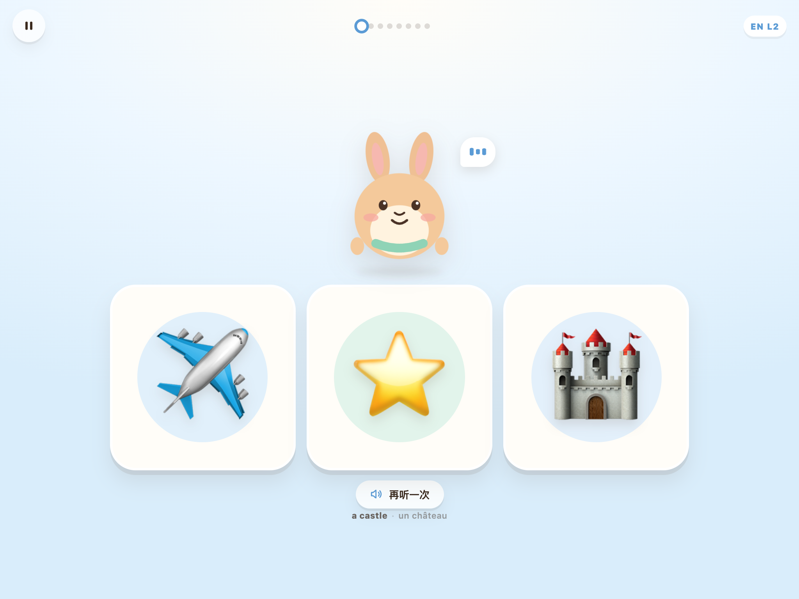

# Momo 的单词篮子

给 **2 岁 10 个月** 的双语宝宝做的「听音找图」小游戏：看图片、听英语/法语、点一下。
一轮 3–5 分钟，到点就结束；家长长按进入设置。

**在线玩：** <https://limengke123.github.io/happy-learning/>  
**源码：** <https://github.com/limengke123/happy-learning>



---

## 先说清楚：那个「快 10–600 倍」

「大脑处理图像比文字快 10–600 倍」更像一个被反复转述的区间，而不是可以直接拿来定产品参数的结论。它把「看一眼图」「读一个词」「理解一句话」混在了不同任务、不同测量口径里；具体倍数会随熟悉度、任务难度、测的是反应时还是记忆效果而大幅变化，学界并没有一个统一的 10–600 倍换算。

对 2 岁 10 个月的孩子，真正有意义的事实是：

1. **她还不识字。** 文字对她本来就不是可用的输入通道，所以「图 vs 文」的对比在这个年龄并不成立。
2. **图片 + 语音 + 动作，比单一通道更容易留下记忆。** 这对应双编码（dual coding）和图片优势效应（picture superiority effect）：同一个概念同时有视觉和听觉表征，提取时多一条线索。
3. **决定效率的不是「播得多快」，而是注意力、情绪和提取练习。** 2–3 岁的工作记忆只能同时抓住 2–3 个对象；一次给 8 个全新词，不如 3 个新词 + 5 个复习词，靠多轮重复。
4. **屏幕不是主体。** 真实物品、父母的声音、身体动作，才是这个年龄最有效的语言输入。游戏的作用是把这三样「串起来」，而不是替代它们。

所以这个游戏没有做「高速闪卡」，而是反过来：**图片大、选择少、语速慢、留等待时间、错两次才提示、到点就停。**

> 屏幕时间参考：WHO 2019 建议 2–4 岁每天久坐屏幕时间不超过 1 小时，越少越好；AAP 建议 2–5 岁每天不超过 1 小时高质量内容，并且家长共同观看。这个游戏按「一次 3–5 分钟」设计，建议每天最多 1–2 轮。

---

## 游戏里有什么

- **60 个词**：基础 24 个 + 进阶 31 个 + 兴趣 5 个（Elsa、雪花、冰、魔法棒、城堡）。
  - 进阶 31：动物 8（大象、狮子、老虎、猴子、长颈鹿、企鹅、斑马、乌龟）、交通 7（火车、飞机、船、自行车、火箭、公交车、直升机）、食物 5（橙子、葡萄、胡萝卜、蛋糕、饼干）、自然 4（彩虹、云、雨、山）、家居 4（椅子、床、钟、雨伞）、身体 3（手、眼睛、鼻子）。
  - 5 个兴趣词会优先排进第一轮，Elsa 不用等随机抽到。
- **一轮 8 个不同词，一轮内不重复**：双语模式约 4 个英语 + 4 个法语（按复习需要微调）；单语模式 8 个同语言词。第一轮后每轮保留 3 个新词，其余是到期复习。
- **三种模式，英法分开设置**：English / Français / 双语；英语和法语各有独立难度，互不迁就。
- **每轮 6 / 8 / 10 次**（默认 8 次），中间穿插一次动作休息。
- **三选一，主界面只有图 + 声音**：孩子听提示句，点对应的图片；底部有一行可关闭的家长文字提示。
- **英语 3 档 / 法语 2 档**：

| 语言 | 档位 | 示例 |
|---|---|---|
| 英语 | L1 单词句 | `An apple. Find the apple.` |
| 英语 | L2 两句话（默认） | `It's red and round, and it grows on a tree. Find the apple.` |
| 英语 | L3 听描述猜 | `It's red and round, and it grows on a tree. Which one is it?` |
| 法语 | L1 简短 | `Une pomme. Trouve la pomme.` |
| 法语 | L2 形容句（默认） | `C'est une pomme rouge et ronde. Trouve la pomme.` |


- **英法独立出题**：双语模式一轮 8 个不同概念，4 英 + 4 法；同一个词不在一轮内以两种语言重复。两个语言版本分别记录，跨轮次复习。英语可以开到 L3，法语停在 L2，互不影响。
- **法语带冠词**：`une pomme`、`un chat`、`du lait`、`de l'eau`。冠词和名词一起学，避免以后返工性别。
- **间隔重复**：每个词、每种语言单独记录熟练度；间隔为 1 / 2 / 4 / 8 / 16 轮。答对升级，答错降一级并安排下一轮再出现。
- **温和纠错**：点错没有红叉、没有失败音效；那张卡变暗，再错一次目标卡会发光。两次之后基本只剩正确答案，保持成功率。
- **动作插曲（TPR）**：一轮中间插入 `Clap your hands!` / `Tape des mains !`，让孩子站起来做动作，把屏幕时间切成两段。
- **结束即停**：一轮结束后进入「星星 + 小篮子」结算页，不提供无限下一轮；「再玩一次」需要家长/孩子明确再点一次。
- **三档语速**：慢 0.8× / 标准 1.0× / 快 1.2×，只改变播放速度，不改变句子难度。
- **家长区**：长按首页的「家长设置」1 秒进入；可分别改英语/法语难度、切换本轮语言、设置次数、语速、文字提示、查看每个词的熟练度、清空记录。普通点一下只会提示「长按」。
- **离线、无账号、无上传**：所有进度存在本机 `localStorage`，音频是本地文件。

---

## 为什么这样设计

| 设计 | 依据 / 目的 |
|---|---|
| 3 选 1 | 2–3 岁工作记忆容量有限，3 个选项既有挑战又不至于过载 |
| 只给图 + 声音 | 前识字期，文字不是有效通道；家长提示可以关掉 |
| 英法独立出题 | 一轮不重复，扩大词汇接触面；两个语言版本分别记录，跨轮复习 |
| 法语带冠词 | 性别是名词的一部分，输入时一次给对 |
| 每轮 8 个不同词 | 一轮内去重，避免同一词反复出现；词汇量从 24 扩到 60 |
| 第一轮 8 个新词，之后每轮 3 个 | 先建立一轮完整词表，再复习为主、持续加新词 |
| 语速三档 | 听熟后加速，不改变句子难度 |
| 英语 L2/L3 用两句话 | 2000+ 听力词汇需要更长的句法、形容词和关系从句输入，而不是只换名词 |
| 英语 L3 不报词名 | 逼孩子把描述和图片匹配，避免「只等名词出现」 |
| 英法难度独立 | 英语强、法语起步时，各自停在合适档位，不互相拖累 |
| 错两次才发光提示 | 降低挫败感，保持「我能做到」的体验 |
| 动作插曲 | TPR（全身反应法）：身体参与能帮助记忆，也能打断久坐 |
| 结束页 + 小篮子 | 给一个清晰的结尾和「今天学了什么」的回看 |
| 长按进设置 | 防止 2 岁小朋友误触改设置 |

---

## 运行

```bash
cd /Users/brady/Documents/codebase/enjoy
python3 -m http.server 8765
```

电脑上打开 <http://localhost:8765>。

iPad 上玩：

1. Mac 和 iPad 连同一个 Wi-Fi；
2. 查 Mac 的局域网 IP：`ipconfig getifaddr en0`；
3. iPad Safari 打开 `http://<那个IP>:8765`；
4. Safari → 分享 → 添加到主屏幕，之后可以全屏打开。

> 直接双击 `index.html` 在桌面 Chrome 里也能玩（已实测，音频和本地进度都正常）；但 iPad 上建议用上面的本地服务器，或者部署到 Netlify / Vercel 之类的静态托管。

第一次进入后点「开始玩」才会出声——这是浏览器的自动播放限制，不是 bug。

---

## 建议的使用节奏（2 岁 10 个月）

- **第 1–2 周：单语模式**，固定时段（比如晚饭后），每天 1 轮。先让「听音—指图」变成熟悉的小仪式，不追求记住多少。
- **第 3–4 周：换另一种语言**，还是这 8 个词。孩子会开始发现「同一个东西有两个名字」。
- **稳定后再用双语模式**。双语模式不是越早越好；如果她明显困惑、烦躁，或者两种语言混在一句话里，退回单语输入更清晰。
- **英语默认 L2**；如果她能轻松完成，切 L3。L3 第一次可以先由家长指着图示范一遍，再让她自己听。
- **法语默认 L2**。`grand`、`vert`、`rouge`、`rond` 这些形容词本身就是输入，不要为了「听懂」而把形容词删掉。
- **先标准语速，听熟后再切 1.2×**。不要同时加难度和语速；一次只动一个变量，才知道她是因为听不懂还是因为太快。
- **每次结束都去家里找一件真实的对应物品**。屏幕上学到的词，要在实物上「落地」，这一步比多刷一轮更重要。

---

## 换成爸爸妈妈的声音（最值得做的一步）

TTS 清楚，但替代不了熟悉的声音。最简单的升级方式：**不改代码，直接替换音频文件。**

文件名规则：

```
audio/en/apple_prompt.mp3    L1  "An apple. Find the apple."
audio/en/apple_prompt2.mp3   L2  "It's red and round, and it grows on a tree. Find the apple."
audio/en/apple_prompt3.mp3   L3  "... Which one is it?"
audio/en/apple_praise.mp3        "An apple! Well done!"
audio/fr/apple_prompt.mp3    L1  "Une pomme. Trouve la pomme."
audio/fr/apple_prompt2.mp3   L2  "C'est une pomme rouge et ronde. Trouve la pomme."
audio/fr/apple_praise.mp3        "Une pomme ! Bravo !"
```

只需要录你实际会用的那一档；没有替换的档位会自动退回 TTS，不会报错。

通用音频：

```
audio/en/intro.mp3   "Let's play!"
audio/en/retry.mp3   "Hmm... try again."
audio/en/end.mp3     "You did it! Bravo!"
audio/fr/intro.mp3   "On joue !"
audio/fr/retry.mp3   "Hmm... essaie encore."
audio/fr/end.mp3     "C'est fini ! Bravo !"
```

动作音频：`audio/en/clap.mp3`、`audio/fr/clap.mp3`（还有 `nose`、`jump`、`wave`、`dance`）。

录制建议：

- 安静房间，手机自带录音即可；离嘴 15–20 cm，不要喷麦。
- 每条 1.5–5 秒（按句子长度），句首留 0.2 秒，句尾留 0.3 秒；不要喊，用平时讲绘本的声音。
- 导出 m4a 后转成 mp3：

```bash
ffmpeg -i take.m4a -ac 1 -ar 24000 -b:a 48k audio/en/apple_prompt.mp3
```

- 先只录 4–6 个词试试，不用一次录完 60 个。孩子常玩的那几个词最值得用真人声。
- 如果只替换 prompt，praise/retry 仍是 TTS，会有一点「混音」；介意的话把同一组词的 praise 也录了。

---

## 加词 / 改词

所有词都在 `index.html` 里的 `<script id="word-data" type="application/json">` 块中，改完运行：

```bash
python3 tools/generate_audio.py
```

脚本会自动读取这个 JSON，为每个词生成 `prompt`、`prompt2`（、`prompt3`）和 `praise` 音频，并生成动作和通用音频。依赖：`edge-tts`、`ffmpeg`。

- **只加新词**：直接跑上面的命令，已有的爸妈录音不会被覆盖。
- **改了已有词句**：先删掉对应的 mp3，或加 `--force`；但 `--force` 会覆盖整个 `audio/` 里的同名文件，包括你录的音，先备份。

```bash
python3 -m pip install edge-tts
```

一个词条的格式：

```json
{
  "id": "apple",
  "emoji": "🍎",
  "cat": "food",
  "en": {
    "phrase": "an apple",
    "prompts": [
      "An apple. Find the apple.",
      "It's red and round, and it grows on a tree. Find the apple.",
      "It's red and round, and it grows on a tree. Which one is it?"
    ],
    "praise": "An apple! Well done!"
  },
  "fr": {
    "phrase": "une pomme",
    "prompts": [
      "Une pomme. Trouve la pomme.",
      "C'est une pomme rouge et ronde. Trouve la pomme."
    ],
    "praise": "Une pomme ! Bravo !"
  }
}
```

注意：

- `id` 用小写英文，不能重复；数组第 1 / 2 / 3 条分别对应 `id_prompt.mp3` / `id_prompt2.mp3` / `id_prompt3.mp3`。
- 法语务必带冠词；英语短句里用 `the` 或 `a/an`，不要只留一个孤零零的名词。
- 干扰项会优先选「不同类别」的词；如果两个词长得太像（香蕉 vs 月亮、猫 vs 狗），可以在 `index.html` 的 `CONFUSE` 里加一条，避免它们互相当干扰项。
- 一次不要加太多。现在 60 个词已经不少；新词以每轮 3 个的速度进入，真正稳定掌握 6–12 个之后再考虑扩主题。

---

## 实测记录

在 macOS Chrome（Playwright 无头）上跑过：

- 1024×768（iPad 横屏）、390×844（手机竖屏）、844×390（手机横屏）；
- 双语完整 8 次：8 个不同概念、结算页 8 个词、8 颗星；4 英 + 4 法；
- 单语 6 次：6 个不同词，全部为英文；
- 英语 L1 / L2 / L3 与法语 L1 / L2 分别切换，预览句、实际播放文件、徽章等级一致；
- 错误路径：第一次错 → 卡片变暗；第二次错 → 目标卡发光；再点对 → 正常进入下一题；
- 暂停/继续、长按设置、刷新后进度保留；
- `file://` 直接打开可正常开始；
- 436 条音频全部生成并通过时长检查，实际播放请求均返回 200/206，控制台无报错；
- 语速 0.8× / 1.0× / 1.2× 切换后，实际播放速率与设置一致；
- 第二轮验证：仍是 8 个不同词，其中 3 个新词、5 个到期复习；
- 第一轮验证：5 个兴趣词（Elsa、雪花、冰、魔法棒、城堡）全部进入首轮。

截图在 `shots/`。

---

## 已知限制 & 下一步

**限制**

- 目前用 edge-tts 的神经语音（Jenny / Denise），不是真人；换成爸妈录音会明显更好。
- 难度是「每种语言一个全局档位」，不是每个词单独设难度；如果你需要按词精细控制，可以下一步加。
- 间隔重复按「轮」而不是按「天」计算。建议一天玩 1–2 轮；如果一天玩很多轮，复习会偏密。
- 用 emoji 而不是实物照片，便利但不够「真实世界」。最好配合家里的真实物品。
- 只有一个学习档案，进度只在本机；换浏览器/清缓存会丢。
- Elsa 属于 Disney 角色，这组词只建议家庭自用；公开分发请换成原创角色或取得授权。
- 这个游戏练的是「听音指物」的接受性词汇，不是让孩子开口说；开口靠家长在真实场景里示范、等待和回应。
- 不是语言评估工具。如果担心孩子的语言发育，请咨询儿科医生或言语治疗师。

**下一步可以加**

1. 爸妈录音的界面（现在用替换文件实现）。
2. 实物照片卡片，提升泛化。
3. 更多词包：动词、方位词（in/on/under）、身体部位、餐具。
4. 家长–孩子轮流说、孩子指实物、录音回放。
5. 按「天」的间隔重复 + 多孩子档案 + 导出。
6. PWA / 原生壳，彻底离线、全屏、无地址栏。

---

## 给家长的 3 分钟陪玩脚本

1. **开始前**：桌上放 3 个真实物品（苹果、球、小兔子）。告诉孩子：「Momo 说 apple，你帮它找一找。」
2. **第一轮**：家长先指一下屏幕上的苹果，再指桌上的苹果；孩子点对了就跟着 Momo 说「An apple!」，击掌。
3. **孩子点错**：不要说「错了」，说「这是 ball，apple 在这里」，把她的手带到正确卡片上；游戏本身也会把错误卡片变暗。
4. **结束后**：去厨房/玩具箱找真的 apple 或 ball，用英语和法语各说一次；找到就结束。
5. **法语**：尽量固定一个人、一个时间段说法语（OPOL 或固定场景），不要每句都翻译；孩子需要的是「这个人/这个场景 = 这个语言」的稳定线索。

> 最重要的规则：**在孩子还想玩的时候结束。** 让「下次还能玩」比「这次玩够」更有价值。

---

## 参考

- WHO. *Guidelines on physical activity, sedentary behaviour and sleep for children under 5 years of age* (2019). <https://www.who.int/publications/i/item/9789241550505>
- AAP. *Media and Young Minds* (2016). <https://publications.aap.org/pediatrics/article/138/5/e20162591/60503/Media-and-Young-Minds>
- Paivio, A. *Mental Representations: A Dual Coding Approach* (1986).
- 图片优势效应（picture superiority effect）与间隔提取（spaced retrieval）是认知心理学中比较稳定的现象；具体到某个孩子，仍要按她的注意力与兴趣调整。

声音由 Microsoft Edge TTS 生成，仅建议个人使用；公开分发前请确认语音服务条款，或改用爸妈录音/有授权的音色。Momo 的 SVG 形象是原创的；emoji 由操作系统渲染。
